<p align="center">
  
</p>

<p align="center">
  <a href="https://github.com/sheikhzainfiaz">
    
  </a>
</p>

<p align="center">
  
  
</p>

<p align="center"></p>

## ` > whoami `

```swift
import SwiftUI

struct ZainFiaz: Developer, Designer {
    let roles      = ["iOS Developer", "macOS Developer", "UI/UX Designer", "Content Creator"]
    let builds     = ["SwiftUI", "UIKit", "AppKit"]
    let designsIn  = ["Figma", "Adobe XD", "Photoshop", "Illustrator"]
    let focus      = "Native Apple experiences that feel effortless"
    let channel    = "youtube.com/mztech92"

    var body: some View {
        Text("Merging creativity with technology 🚀")
            .font(.system(.title, design: .rounded))
            .foregroundStyle(.linearGradient(colors: [.blue, .purple, .pink],
                                             startPoint: .leading, endPoint: .trailing))
    }
}
```

<p align="center"></p>

## 🍏 Apple Platforms

<p align="center">
  
  
  
  
  
  
</p>

## 🎨 Design · 🌐 Web · 🧰 Tools

<p align="center">
  <br/><br/>
  
</p>

<p align="center">
  <sub>Wireframing • User Flows • Accessibility (HIG-first) • Branding • Logo Design • Brand Kits</sub>
</p>

<p align="center"></p>

## 🛰️ Featured Projects

<table>
  <tr>
    <td width="33%" valign="top">
      <h3>🧠 Attend Smart</h3>
      <p>Face recognition–based attendance system wrapped in a sleek, minimal UI.</p>
      <a href="https://github.com/sheikhzainfiaz/Attend_Smart"></a>
    </td>
    <td width="33%" valign="top">
      <h3>📇 Contact Book</h3>
      <p>Complete branding and interface design for a fast, high-performance contact manager.</p>
      <a href="https://github.com/sheikhzainfiaz/ContactBook"></a>
    </td>
    <td width="33%" valign="top">
      <h3>🔴 Connect Four</h3>
      <p>Where it all started: my very first project, a classic strategy game.</p>
      <a href="https://github.com/sheikhzainfiaz/ConnectFourGame"></a>
    </td>
  </tr>
</table>

<p align="center"></p>

## 📡 Telemetry

<p align="center">
  
  
</p>

<p align="center">
  
</p>

<p align="center">
  <picture>
    <source media="(prefers-color-scheme: dark)" srcset="https://raw.githubusercontent.com/sheikhzainfiaz/sheikhzainfiaz/output/github-snake-dark.svg" />
    <source media="(prefers-color-scheme: light)" srcset="https://raw.githubusercontent.com/sheikhzainfiaz/sheikhzainfiaz/output/github-snake.svg" />
    
  </picture>
</p>

<p align="center"></p>

## 🌐 Connect

<p align="center">
  <a href="https://github.com/sheikhzainfiaz"></a>
  <a href="https://www.youtube.com/mztech92"></a>
  <a href="https://linkedin.com/in/sheikhzainfiaz"></a>
  <a href="https://x.com/sheikhzainfiaz"></a>
</p>

<p align="center">
  <i>"Design is not just what it looks like and feels like. Design is how it works."</i><br/>
  <sub>— Steve Jobs</sub>
</p>

<p align="center">
  
</p>
